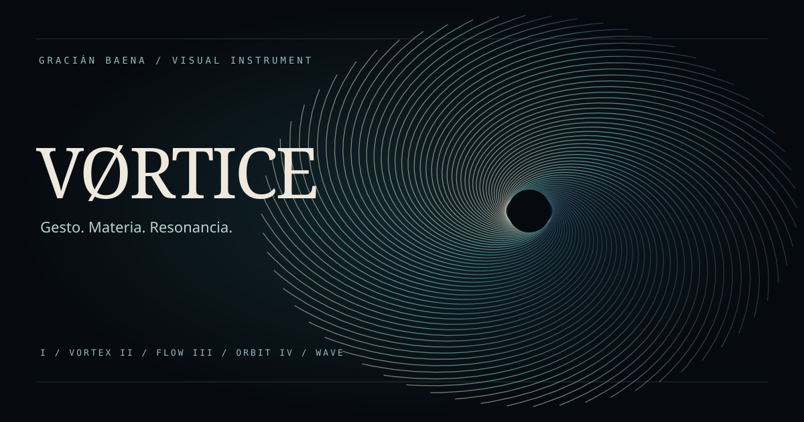

<div align="center">

<a href="https://vortex-gilt-xi.vercel.app/">
  
</a>

# VØRTICE

**El campo responde.**

Arte generativo audiovisual en **WebGL**. No es un vídeo: miles de puntos reaccionan al movimiento, el ritmo y las decisiones del visitante.

[**Abrir experiencia ↗**](https://vortex-gilt-xi.vercel.app/) · [**Entrar desde Systems Lab ↗**](https://gracianb.github.io/systems-lab/#vortex-live) · [**Controles**](docs/CONTROLS.md) · [**English**](#english)

</div>

---

## Un instrumento, cuatro movimientos

| 01 Vórtice | 02 Flujo | 03 Órbita | 04 Onda |
| --- | --- | --- | --- |
| Atracción hacia el puntero | Corrientes y estelas | Movimiento orbital | Pulsos que modifican el campo |

**Haz algo, y el campo responde:** mueve el cursor, mantén pulsado, cambia el movimiento o abre el panel de instrumentos. Seis estados maestros combinan color y ambiente: Void, Aurora, Solar, Ember, Ice y Paper.

Los controles están diseñados para exploración: `1–4` movimientos, `I` panel, `H` solo lienzo, `Espacio` pulso, `M` audio, `S` captura PNG. [Ver todos los controles ↗](docs/CONTROLS.md).

## Lo que demuestra

- Motor WebGL con simulación en tiempo real y recuperación del contexto.
- React 19 + TypeScript, Vite y estado compartible por URL.
- Adaptación al rendimiento del dispositivo, móvil y movimiento reducido.
- Audio ambiental opcional y sutil; sin cuenta de usuario.
- Cuatro movimientos, presets/estados visuales, modo embed y captura.
- Calidad reproducible con TypeScript, ESLint, pruebas unitarias y E2E Chromium.

## Ejecutarlo localmente

**Node 24** (ver `.nvmrc`).

```bash
git clone https://github.com/GracianB/vortex.git
cd vortex
npm ci
npm run dev
```

Abre **http://localhost:8080/**.

```bash
npm run quality          # tipos, lint, tests, build y presupuesto
npm run test:browser     # E2E Chromium real
npm run smoke:live       # comprueba la URL pública externa
```

El workflow **Vórtice Quality** protege los cambios. El workflow manual **Vórtice Production Smoke** verifica la URL pública, sus cabeceras y E2E directo. Una ejecución verde de Quality **no garantiza** que Vercel haya publicado el commit actual.

## Arquitectura y evidencia

[**Estructura y decisiones**](docs/ARCHITECTURE.md) · [**Controles y accesibilidad**](docs/CONTROLS.md) · [**Pruebas y estado del release**](docs/RELEASE_STATUS.md) · [**Certificado histórico V6**](RELEASE_V6.md) · [**CI**](https://github.com/GracianB/vortex/actions)

El laboratorio principal conserva un **póster estático** de Vórtice en claro/oscuro y solo carga el iframe al activarlo. El render WebGL vive en este proyecto, no en Systems Lab.

## English

Vórtice is a real-time **WebGL audiovisual instrument**, not a pre-rendered video. Four movements, six curated visual states and optional ambient audio respond to pointer and keyboard input. Its shared URLs preserve scene settings. The renderer adapts to device capabilities and honors reduced motion. [Launch](https://vortex-gilt-xi.vercel.app/) · [Controls](docs/CONTROLS.md) · [Local setup](#ejecutarlo-localmente).
