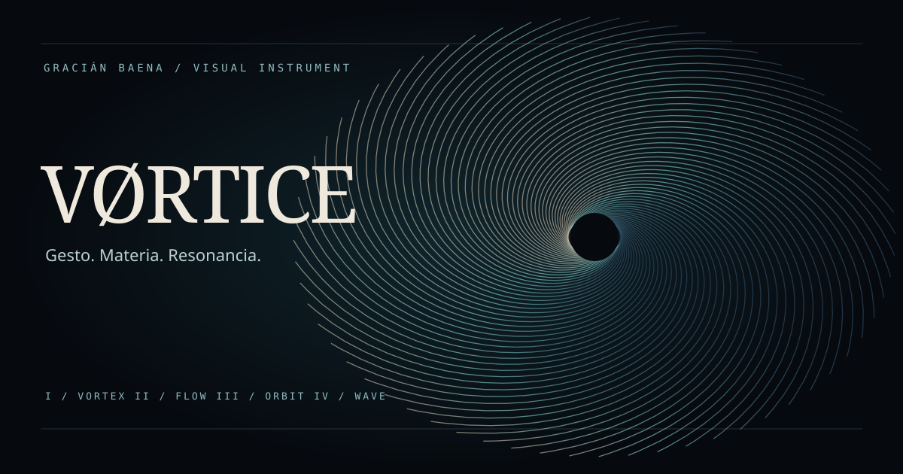

<div align="center">

<a href="https://vortex-gilt-xi.vercel.app/">
  
</a>

# VØRTICE

**El campo responde.**

Arte generativo audiovisual en **WebGL**. No es un vídeo: miles de puntos reaccionan al movimiento, el ritmo y las decisiones del visitante.

[**Abrir experiencia ↗**](https://vortex-gilt-xi.vercel.app/) · [**Entrar desde Systems Lab ↗**](https://gracianb.github.io/systems-lab/#vortex-live) · [**Controles**](docs/CONTROLS.md) · [**English**](#english)

</div>

---

## Un instrumento, siete movimientos

| 01 Vórtice | 02 Flujo | 03 Órbita | 04 Onda | 05 Caos | 06 Singularidad | 07 Supernova |
| --- | --- | --- | --- | --- | --- | --- |
| Atracción centrípeta | Corrientes y estelas | Gravitación orbital | Pulsos y resonancia | Turbulencia browniana | Horizonte y chorros cuánticos | Detonación y dispersión |

**Haz algo, y el campo responde:** mueve el cursor, inclina el móvil, mantén pulsado, cambia el movimiento o abre el panel de instrumentos. Once estados maestros combinan color, física y atmósfera: Void, Aurora, Solar, Ember, Ice, Paper, Storm, Galaxy, Singularity, Supernova y Celestial.

Los controles están diseñados para exploración: `1–7` movimientos, `P` escena aleatoria, `I` panel, `H` solo lienzo, `Espacio` pulso con onda de choque, `M` audio y sintetizador armónico, `S` captura PNG, `V` grabación de vídeo cinemático WebM. [Ver todos los controles ↗](docs/CONTROLS.md).

## Lo que demuestra

- Motor WebGL de alto rendimiento con hasta 32.000 partículas en tiempo real y recuperación del contexto.
- React 19 + TypeScript, Vite y persistencia de escena compartible por URL.
- Adaptación al rendimiento del dispositivo, móvil con soporte giroscópico y movimiento reducido.
- Síntesis armónica procedural Web Audio combinada con audio ambiental opcional.
- Siete movimientos, 11 presets maestros, ondas de choque físicas, grabación de vídeo WebM y captura.
- Calidad reproducible con TypeScript, ESLint, pruebas unitarias y E2E Chromium.

## Ejecutarlo localmente

**Node 24** (ver `.nvmrc`).

```bash
git clone https://github.com/GracianB/vortex.git
cd vortex
npm ci
npm run dev
```

Abre **http://localhost:8080/**.

```bash
npm run quality          # tipos, lint, tests, build y presupuesto
npm run test:browser     # E2E Chromium real
npm run smoke:live       # comprueba la URL pública externa
```

El workflow **Vórtice Quality** protege los cambios. El workflow manual **Vórtice Production Smoke** verifica la URL pública, sus cabeceras y E2E directo. Una ejecución verde de Quality **no garantiza** que Vercel haya publicado el commit actual.

## Arquitectura y evidencia

[**Estructura y decisiones**](docs/ARCHITECTURE.md) · [**Controles y accesibilidad**](docs/CONTROLS.md) · [**Pruebas y estado del release**](docs/RELEASE_STATUS.md) · [**Certificado histórico V6**](RELEASE_V6.md) · [**CI**](https://github.com/GracianB/vortex/actions) · [**GitHub Settings**](docs/REPOSITORY_SETTINGS.md)

El laboratorio principal conserva un **póster estático** de Vórtice en claro/oscuro y solo carga el iframe al activarlo. El render WebGL vive en este proyecto, no en Systems Lab.

## English

Vórtice is a real-time **WebGL audiovisual instrument**, not a pre-rendered video. Seven movements, eleven curated visual states, physical shockwaves, WebM cinematic video recording, mobile gyroscope tilt dynamics, and generative harmonic audio respond to pointer, motion and keyboard input. Its shared URLs preserve scene settings. The renderer adapts to device capabilities and honors reduced motion. [Launch](https://vortex-gilt-xi.vercel.app/) · [Controls](docs/CONTROLS.md) · [Local setup](#ejecutarlo-localmente).
